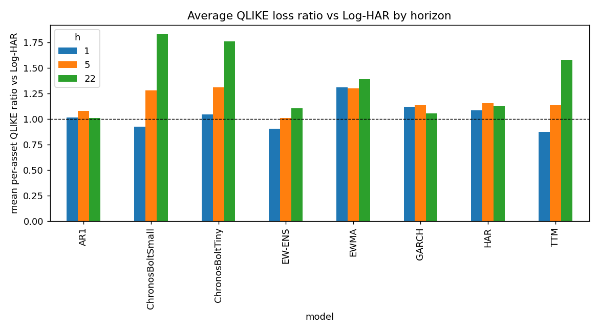

# rv-tsfm-bench

Do zero-shot time series foundation models beat HAR-family econometric models
for realized volatility forecasting? A weekend-scale, free-data replication of
the core questions in arXiv:2607.05291 (Brini, 2026), on two tracks of real
market data:

- **Track A**: 30 assets (13 equity ETFs, 7 FX pairs, 10 futures), daily
  range-based RV (Garman-Klass / Parkinson) from free OHLC, 2005 to 2026,
  750 out-of-sample days per asset.
- **Track B**: true 5-minute realized volatility computed from Binance's full
  1-minute trade history for BTC, ETH, BNB, XRP, SOL (the same construction
  as the paper's VOLARE dataset, on a 24/7 market), 750 out-of-sample days
  per symbol.

See SPEC.md for the full specification and PLAN.md for implementation
conventions (alignment, rolling re-estimation, lognormal corrections).

## Setup

```
pip install -r requirements.txt
```

CPU-only torch is sufficient. Python 3.10 (also verified on Python 3.13 with
pandas 3).

## Usage

```
python -m src.run --quick            # 6 assets, 200 test days, smoke run
python -m src.run                    # full Track A universe, 750 test days
python -m src.run --track b          # Track B: crypto 5-min RV from Binance
python -m src.run --track b --quick  # BTC+ETH, 200 test days
python -m src.run --stage evaluate   # re-evaluate from cached forecasts
python -m src.run --models LogHAR,TTM --force-forecast
python -m src.run --end-date 2026-07-10 --out results_rerun  # pin the data window
```

Stages: `download`, `forecast`, `evaluate`, `all` (default). Raw OHLC is
cached in `data/` as parquet; forecasts are cached in
`results/forecasts.parquet` keyed by (asset, model, h, origin_date), so
re-runs skip completed model-asset pairs unless `--force-forecast`.

## Models

- Econometric (rolling window 1000, refit every 22): HAR, Log-HAR (reference
  benchmark), AR(1) on log RV, EWMA (lambda 0.94), GARCH(1,1).
- Zero-shot TSFMs (context 512): Chronos-Bolt tiny, Chronos-Bolt small,
  TTM (granite-timeseries-ttm-r2).
- EW-ENS: equal-weight average of TTM and Log-HAR in forecast RV space.

## Evaluation

QLIKE on variance (primary) and MSE on annualized vol; horizons h = 1, 5, 22
(multi-day target = mean daily variance over the h days). Diebold-Mariano
tests vs Log-HAR with Newey-West (Bartlett, lag h-1) and the
Harvey-Leybourne-Newbold correction. Mincer-Zarnowitz (MZ) recalibration
separates genuine dynamics information from forecast scaling, under two
schemes:
- `+MZ`: rolling log-log OLS on the trailing 250 realized pairs.
- `+MZL`: the paper's scheme, an expanding-window affine fit on the
  volatility level with a 252-pair warm-up.

Each recalibrated model is compared with Log-HAR recalibrated the same way
(`mz_like_for_like` tables, with DM tests). The older `mz_effect` table
compares recalibrated models with *raw* Log-HAR, which is not like-for-like.

Outputs land in `results/`: `universe.md`, `forecasts.parquet`,
`losses.parquet`, `tables/*.md` + `tables/*.parquet`, and three figures.

## Reproducibility

All nine models were re-run from scratch on freshly downloaded data pinned
with `--end-date` (2026-07-10 for Track A, 2026-06-30 for Track B).

| Re-run vs cached | Track A, 28 of 30 assets | Track B, all 5 symbols |
|---|---|---|
| HAR, Log-HAR, AR1, EWMA | Match to about 1e-14 | Match to about 1e-14 |
| GARCH | Within 0.34 percent | Within 0.02 percent |
| TSFMs | Median relative difference 2e-8 | TTM within 1e-6, Chronos within 0.7 percent |
| Tables | Per-asset ratios within 0.001 | Within 3e-5 |

GC=F and USDCHF=X differ only because Yahoo has revised their history. GC=F
gained about 33 trading days inside the test window. The re-run tables are in
`results_rerun/`; the full audit is in VALIDATION.md.

## Findings

Full tables in `results/tables/` (Track A) and `results/tables_crypto/`
(Track B). Headline numbers below are per-asset mean QLIKE ratios vs Log-HAR
(lower is better, 1.00 = tie) and Diebold-Mariano significance at 5 percent.



All numbers below use the paper's exact TTM checkpoint (branch 512-96-ft-r2.1
of granite-timeseries-ttm-r2). An earlier run with the repo's main branch
produced materially worse TTM results (QLIKE 9 to 24 percent higher); see
finding 4.

**1. At the 1-day horizon, zero-shot foundation models are genuinely
competitive, and on true high-frequency RV they win.**
- Track A: TTM and Chronos-Bolt-Small both sit at parity with Log-HAR
  (ratios 0.998 and 1.000). Chronos is significantly better on 10 percent of
  assets, and neither model is significantly worse anywhere.
- Track B (real 5-min crypto RV): TTM scores 0.876 (DM significantly better
  on 3 of 5 symbols, worse on none) and Chronos small 0.922 (significantly
  better on BTC and ETH).
- The crypto edges survive a like-for-like MZ test, where each model faces
  Log-HAR recalibrated the same way. TTM scores 0.888 and Chronos small
  0.902 under the rolling scheme, and 0.908 and 0.909 under the paper's
  scheme. TTM is significantly better on 2 of 5 symbols (rolling) or 3 of 5
  (paper's scheme), and worse on none.
  So on high-frequency RV this is genuine dynamics information, not scaling.
- On Track A there is no raw edge to decompose. TTM stays at parity after
  recalibration (1.003 rolling, 0.986 paper scheme).

**2. At 5-day and 22-day horizons, raw econometric forecasts win clearly,
but the gap is mostly a scaling problem.**
- Raw TSFM ratios are 1.14 to 1.83 beyond h = 1. This is where our raw
  results diverge from the paper, which found TTM narrowly ahead at all
  horizons.
- Under like-for-like recalibration the gap disappears. TTM vs recalibrated
  Log-HAR at h = 5 / 22:

  | Scheme | Track A | Track B |
  |---|---|---|
  | Rolling log-log | 0.999 / 0.976 | 1.006 / 1.012 |
  | Paper's scheme | 0.963 / 0.933 | 0.973 / 0.954 |

  Chronos small behaves the same way. The TSFMs carry the dynamics
  information but are badly scaled at long horizons. That matches the
  paper's finding that a genuine informational gain remains at the monthly
  horizon.
- The catch: here, both recalibration schemes make Log-HAR itself worse
  than raw Log-HAR, by 5 to 56 percent at h = 22. In the paper, its scheme
  improved Log-HAR. So beyond h = 1 raw Log-HAR remains the best forecast
  you can actually use, and the TSFMs only win after a recalibration that
  also handicaps the benchmark.

**3. The TTM + Log-HAR ensemble now partially replicates.** EW-ENS beats
Log-HAR at h = 1 on both tracks (0.984 on Track A, 0.903 on Track B, DM
significantly better on 10 and 80 percent of assets respectively), is at
parity at h = 5 (1.039 / 1.011), and loses modestly at h = 22 (1.062 /
1.106). It is also the most robust non-benchmark model: significantly worse
than Log-HAR almost nowhere. The paper's "average TTM with Log-HAR" advice
holds here at short horizons but not, on raw forecasts, at the monthly
horizon. After like-for-like recalibration EW-ENS beats recalibrated Log-HAR
at every horizon on both tracks (Track A 0.992 / 0.988 / 0.977 rolling), and
it is never significantly worse.

**4. Checkpoint choice matters as much as architecture choice.** Switching
TTM from the repo default main branch to the paper's frequency-tuned
512-96-ft-r2.1 branch, the same architecture and parameter count (855,100,
verified on the loaded checkpoint), improved TTM's QLIKE by 8 to 19 percent
across horizons and flipped the ensemble
finding from "never beats Log-HAR" to "beats it at h = 1 on both tracks".
This amplifies the paper's most durable finding: within-class model
selection dwarfs the foundation-vs-econometric choice. Relatedly, the
median-vs-mean point forecast distinction is vacuous for Chronos-Bolt in the
chronos-forecasting library, whose Bolt implementation returns the 0.5
quantile as the "mean" (verified in the installed library source and
numerically; the paper describes Chronos-Bolt as exposing a mean head).

| Paper finding (on 5-min VOLARE RV) | Our result | Agree? |
|---|---|---|
| Pooled losses favor TSFMs, edge concentrated in a few assets | TSFM wins concentrate at h=1 and in BTC/ETH on Track B | Yes at h=1, no beyond |
| Per-asset, only TTM narrowly beats Log-HAR at all horizons | TTM at parity (A) and clearly ahead (B) at h=1; raw TTM loses at h=5 and h=22, but is at parity or ahead after like-for-like MZ | Yes at h=1; beyond h=1 only after recalibration |
| Much of the short-horizon TSFM edge is scaling; a genuine gain remains only at the monthly horizon | No raw TTM edge on Track A to remove; crypto h=1 edges survive like-for-like MZ (information); after the paper's MZ scheme, TSFMs beat recalibrated Log-HAR at h=22 on both tracks | Yes on the monthly-horizon gain; no on Track B h=1, where the edge is information |
| TTM + Log-HAR equal-weight ensemble is the most robust choice | EW-ENS beats Log-HAR at h=1 both tracks, parity h=5, modest loss h=22; almost never significantly worse | Partly (short horizons yes) |
| Architecture variance dwarfs the foundation-vs-econometric gap | Yes, and even checkpoint variance within one architecture does (finding 4) | Yes, amplified |

Interpretation of the remaining divergence (raw long horizons): the paper
evaluates 5-minute RV for equities/FX/futures with volatility levels fed to
the models; we evaluate daily range-based proxies (Track A) and 24/7 crypto
5-minute RV (Track B) with log RV inputs. Noisier proxies and a 24/7 market
plausibly both penalize zero-shot models most where scale errors compound,
at the monthly horizon.

### Deviations from the paper (full list, from a close read of the paper)

- Data: daily range-based RV proxies (Track A) and crypto 5-min RV (Track B)
  instead of the paper's VOLARE 5-min RV for 50 equities/FX/futures.
- Forecast target: we use the h-day-average RV target. The paper's headline
  results use the point-in-time target h days ahead and run the h-day average
  as a robustness arm (its Tab. 15, which is the table our ratios should be
  compared against). The top of the paper's ranking holds under both targets,
  but several models move a lot at h = 5 and 22; for example, Toto goes from
  1.157 to 4.070 at h = 22.
- Model scale and point forecast: the paper feeds raw volatility levels to the
  TSFMs and uses the conditional mean as the point forecast. We feed log RV
  and use the median quantile, then apply a trailing lognormal bias
  calibration identically to all log-space models.
- Context length 512 for all TSFMs (paper: 1000 where the architecture allows;
  its Tab. 14 numbers put 512 within 0.002 of the best for Chronos-Bolt,
  though its text says Chronos-Bolt peaks at 128 to 256 days).
- TTM checkpoint: final results use the paper's exact branch (512-96-ft-r2.1
  of granite-timeseries-ttm-r2, 855,100 parameters). An initial run used the
  repo's main branch instead and produced 9 to 24 percent worse TTM QLIKE
  (those tables are preserved in results/baseline_pre_paperfix*/); see
  Findings point 4.
- Econometric estimation: direct-h regressions refit every 22 days. The
  paper re-estimates every model daily; its pure models (HAR, Log-HAR,
  ARFIMA, ARMA, MEM) are iterated multistep, and HAR-J/RS/Q are direct. Benchmark set differs: we include
  EWMA and GARCH(1,1) but not ARFIMA, MEM, or the HAR-J/RS/Q variants, whose
  intraday inputs (bipower variation, semivariance, quarticity) do not exist
  for daily OHLC data.
- We winsorize daily RV at the 0.01 and 99.9 percentiles of each asset's full
  history. That applies to the model inputs and the evaluation targets alike,
  so test-period spikes are trimmed with percentiles that use future data.
  It affects about 0.15 percent of days.
- The paper instead clips forecasts to each asset's full-sample RV support,
  which also includes the test period. It reports the clip binds in 0.05
  percent of cases.
- MZ recalibration: the paper fits an expanding-window affine map on the
  volatility level and compares against recalibrated Log-HAR. We run that
  scheme (`+MZL`) and a rolling log-log one (`+MZ`), both like-for-like.
- We run DM tests and MZ recalibration but not the Model Confidence Set or
  Giacomini-Rossi fluctuation tests.

### How our results line up with the paper's

Our TSFM wrapper is not a substitute for the paper's MZ arm. Its trailing
lognormal calibration adds half the error variance after removing the mean
error, so it neither corrects mean bias nor rescales the slope. The right
counterpart to the paper's MZ table (its Tab. 11) is our like-for-like MZ
comparison (`results_rerun/tables*/mz_like_for_like.md`).

| Horizon | Paper, after MZ | Ours, after MZ (paper's scheme) |
|---|---|---|
| h = 1 | TTM's edge vanishes (0.192 to 0.198, vs recalibrated Log-HAR 0.195). TimesFM 2.5 (0.190) and Chronos-Bolt-Base (0.192) move ahead. | Track A looks similar: TTM 0.986, Chronos small 0.965 vs recalibrated Log-HAR. |
| h = 22 | TTM's informational gain survives (0.484 vs 0.506). | Same on both tracks: TTM 0.933 (A) and 0.954 (B). |

Where we find more than the paper is Track B at h = 1: on crypto 5-minute RV
the TSFM edges survive recalibration, indicating genuine short-horizon
information in that market.

Where we differ is the benchmark itself. Here recalibration weakens
Log-HAR, which is already lognormal-corrected in log space, so the raw
Log-HAR forecast stays the strongest usable one beyond h = 1.
